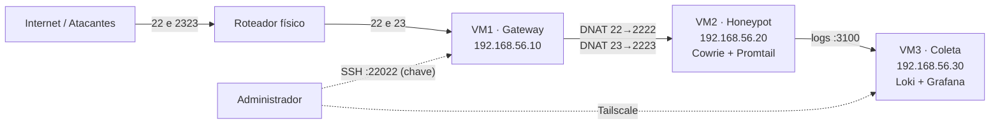

# Honeypot-IoT
# Honeypot IoT — Infraestrutura de Coleta e Análise de Ataques (TCC)

Ambiente completo e replicável de **honeypot de baixa/média interatividade** que emula um dispositivo IoT (câmera IP Hikvision `DS-2CD2143G0-I`) expondo **SSH** e **Telnet** à internet, com coleta de logs, geolocalização/ASN dos atacantes e dashboards de análise.

Stack: **Cowrie** · **Promtail** · **Loki** · **Grafana** · **iptables/nftables** · **fail2ban** · **Tailscale**

> **Aviso:** este projeto expõe deliberadamente serviços vulneráveis simulados à internet. Leia a seção [Ética, legal e segurança](#10-ética-legal-e-segurança) antes de colocar qualquer coisa no ar.

---

## Sumário

1. [Visão geral](#1-visão-geral)
2. [Arquitetura](#2-arquitetura)
3. [Requisitos e versões](#3-requisitos-e-versões)
4. [Passo a passo](#4-passo-a-passo)
   - [4.0 Preparação (todas as VMs)](#40-preparação-todas-as-vms)
   - [4.1 Rede](#41-rede)
   - [4.2 VM1 — Gateway](#42-vm1--gateway)
   - [4.3 VM2 — Honeypot (Cowrie + Promtail)](#43-vm2--honeypot-cowrie--promtail)
   - [4.4 VM3 — Loki e Grafana](#44-vm3--loki-e-grafana)
   - [4.5 Dashboard](#45-dashboard)
   - [4.6 Alertas por e-mail](#46-alertas-por-e-mail)
   - [4.7 Bloqueio automático (VM2)](#47-bloqueio-automático-vm2)
   - [4.8 Hardening](#48-hardening)
   - [4.9 Kill switch](#49-kill-switch-vm1)
   - [4.10 Exposição à internet](#410-exposição-à-internet)
   - [4.11 Validação externa](#411-validação-externa)
   - [4.12 Gestão remota (Tailscale)](#412-gestão-remota-tailscale)
5. [Scripts de auditoria](#5-scripts-de-auditoria)
6. [Checklist pré-exposição](#6-checklist-pré-exposição)
7. [Troubleshooting](#7-troubleshooting)
8. [Limitações conhecidas](#8-limitações-conhecidas)
9. [Antes de iniciar a coleta](#9-antes-de-iniciar-a-coleta)
10. [Ética, legal e segurança](#10-ética-legal-e-segurança)
11. [Estrutura do repositório](#11-estrutura-do-repositório)
12. [Licença e autoria](#12-licença-e-autoria)

---

## 1. Visão geral

O ataque entra pela internet, é redirecionado (DNAT) para o honeypot isolado e todos os eventos são enviados a um servidor de logs separado:

```
Atacante → Roteador → VM1 (DNAT) → VM2 (Cowrie) → Promtail → VM3 (Loki) → Grafana
```

| Componente | Função |
|---|---|
| **Cowrie** | Honeypot SSH/Telnet; registra tentativas de login, comandos e arquivos baixados |
| **Promtail** | Lê `cowrie.json`, enriquece com GeoIP (cidade) e ASN e envia ao Loki |
| **Loki** | Armazena os logs |
| **Grafana** | Dashboards (8 painéis) e alertas por e-mail |
| **iptables** (VM1) | Gateway, NAT/DNAT, firewall de borda e *egress filtering* da VM2 |
| **nftables** (VM2) | Bloqueio temporário automático de IPs após login bem-sucedido |
| **fail2ban** | Proteção do SSH administrativo da VM1 |
| **Tailscale** | Acesso remoto seguro ao Grafana sem expor portas administrativas |

---

## 2. Arquitetura



### 2.1 Máquinas virtuais

| VM | Hostname | IP interno | Placas de rede | Função |
|---|---|---|---|---|
| VM1 | `infra-tcc` | `192.168.56.10` | WAN (`enp0s3`) + interna (`enp0s8`) | Gateway, NAT, firewall |
| VM2 | `honeypot-tcc` | `192.168.56.20` | Somente interna (`enp0s3`) | Cowrie (SSH `2222`, Telnet `2223`) + Promtail |
| VM3 | `coleta-tcc` | `192.168.56.30` | WAN (`enp0s3`) + interna (`enp0s8`) | Loki (`3100`) + Grafana (`3000`) |

A rede interna (`tcc-net`) é isolada, compartilhada pelas 3 VMs e configurada no hypervisor como "Rede Interna". A VM2 **não tem acesso direto à internet**: toda a saída passa pela VM1, que aplica filtragem seletiva.

### 2.2 Matriz de exposição

| Porta | Serviço | Onde | Estado externo (WAN) |
|---|---|---|---|
| 22/TCP | Cowrie SSH (banner Dropbear) | VM1 → VM2:2222 | **ABERTA** |
| 2323/TCP | Cowrie Telnet (persona câmera Hikvision) | Roteador → VM1:23 → VM2:2223 | **ABERTA** |
| 22022/TCP | SSH administrativo | VM1 | Fechada (somente rede interna, chave pública) |
| 3000/TCP | Grafana | VM3 | Fechada |
| 3100/TCP | Loki | VM3 | Fechada |

> A porta externa do Telnet é **2323** (e não 23) porque a operadora usada no projeto filtra a 23/TCP na borda. Se a sua operadora não filtra, pode mapear 23 → 23 direto.

---

## 3. Requisitos e versões

| Item | Versão / observação |
|---|---|
| Sistema operacional | Debian 12 (bookworm), instalação mínima nas 3 VMs |
| Hypervisor | Qualquer um com suporte a rede interna isolada e adaptador em bridge/NAT |
| Cowrie | Clone de `github.com/cowrie/cowrie` (registre o commit usado: `git rev-parse HEAD`) |
| Promtail / Loki | **v2.9.2** |
| Grafana | Repositório APT oficial (`apt.grafana.com`, canal `stable`) |
| Bases GeoIP | GeoLite2-City e GeoLite2-ASN (formato `.mmdb`) |
| Python | `python3-venv` do Debian 12 |

Dimensionamento sugerido (não registrado no projeto original): VM1 e VM2 com 1 vCPU / 1 GB RAM; VM3 com 2 vCPU / 2 GB RAM; 20 GB de disco cada.

Para uma coleta real você também precisa de um **IP público** e acesso ao painel do roteador para redirecionar portas.

### Convenções usadas neste guia

| Placeholder | Significado |
|---|---|
| `<usuario_admin>` | Usuário administrativo de cada VM (no projeto: `infratcc` na VM1) |
| `<IP_PUBLICO_WAN>` | IP público do roteador |
| `<IP_VM1_WAN>` | IP da VM1 na rede do roteador (no projeto: `192.168.15.47`) |
| `<SENHA_DE_APP>` | Senha de app do Gmail (**nunca** commitar) |

---

## 4. Passo a passo

> Execute os blocos na ordem. Antes de cada fase, confirme que a anterior funciona.

### 4.0 Preparação (todas as VMs)

A instalação mínima do Debian não traz `sudo` nem `iptables`.

```bash
# como root
apt update && apt upgrade -y
apt install -y sudo curl wget gnupg2 ca-certificates apt-transport-https \
    iptables iptables-persistent net-tools

usermod -aG sudo <usuario_admin>
exit   # faça login novamente
```

Sincronize o relógio das 3 VMs (importante para correlacionar eventos entre Cowrie, Loki e Grafana):

```bash
sudo timedatectl set-ntp true
timedatectl status
```

### 4.1 Rede

Edite `/etc/network/interfaces` em cada VM e aplique com `sudo systemctl restart networking`.

**VM1**
```
auto enp0s3
iface enp0s3 inet dhcp

auto enp0s8
iface enp0s8 inet static
    address 192.168.56.10
    netmask 255.255.255.0
```

**VM2**
```
auto enp0s3
iface enp0s3 inet static
    address 192.168.56.20
    netmask 255.255.255.0
    gateway 192.168.56.10
    dns-nameservers 8.8.8.8 1.1.1.1
```

**VM3**
```
auto enp0s3
iface enp0s3 inet dhcp

auto enp0s8
iface enp0s8 inet static
    address 192.168.56.30
    netmask 255.255.255.0
```

Teste: `ping` entre as 3 VMs. Se a VM3 não alcançar as demais, revise a configuração da rede interna no hypervisor.

> Os nomes das interfaces (`enp0s3`/`enp0s8`) seguem o padrão previsível do Debian 12 nas VMs do projeto. Confirme os seus com `ip -br link`.

### 4.2 VM1 — Gateway

#### 4.2.1 SSH administrativo na porta 22022

A porta 22 precisa ficar livre para o DNAT do honeypot.

```bash
sudo apt install -y openssh-server
sudo sed -i 's/^#\?Port 22$/Port 22022/' /etc/ssh/sshd_config
sudo systemctl restart ssh
```

Teste (de outra máquina): `ssh -p 22022 <usuario_admin>@192.168.56.10`. O hardening do SSH (chaves, sem senha) está em [4.8](#48-hardening).

#### 4.2.2 Roteamento

```bash
sudo sysctl -w net.ipv4.ip_forward=1
echo "net.ipv4.ip_forward=1" | sudo tee -a /etc/sysctl.conf
sudo sysctl -p
```

#### 4.2.3 NAT / DNAT

```bash
WAN=enp0s3
VM2=192.168.56.20

# Redirecionamento do honeypot
sudo iptables -t nat -A PREROUTING -p tcp --dport 22 -j DNAT --to-destination $VM2:2222
sudo iptables -t nat -A PREROUTING -p tcp --dport 23 -j DNAT --to-destination $VM2:2223

# Saída da rede interna para a internet (VM2/VM3 precisam disso)
sudo iptables -t nat -A POSTROUTING -s 192.168.56.0/24 -o $WAN -j MASQUERADE
```

Opcional — somente se o roteador encaminhar a porta externa 2323 **para a porta 2323** da VM1 (em vez de para a 23):

```bash
sudo iptables -t nat -A PREROUTING -p tcp --dport 2323 -j DNAT --to-destination $VM2:2223
```

> ### ⚠️ Verificação crítica: preservar o IP de origem do atacante
> Durante os testes internos (*hairpin NAT*) foi necessário um `MASQUERADE` com destino à VM2:
> ```bash
> # SOMENTE PARA TESTES INTERNOS — remover antes de expor
> sudo iptables -t nat -A POSTROUTING -d 192.168.56.20 -j MASQUERADE
> ```
> Com essa regra ativa, o Cowrie enxerga **o IP da VM1 como origem de todos os ataques**, o que invalida GeoIP, ASN e o bloqueio automático. Como a VM2 usa a VM1 como gateway, o tráfego de retorno já passa por ela e a regra não é necessária em produção.
>
> **Valide sempre** com uma conexão externa real:
> ```bash
> # na VM2
> sudo tail -n 5 /home/cowrie/cowrie/var/log/cowrie/cowrie.json | grep -o '"src_ip": *"[^"]*"'
> ```
> O `src_ip` deve ser o IP do cliente, nunca `192.168.56.10`. Teste a partir de uma máquina **externa** à VM1; testar de dentro da própria VM1 não funciona (limitação de hairpin NAT).

#### 4.2.4 Política de firewall (FORWARD)

Política restritiva: só passa o que é necessário. A saída da VM2 é **seletiva** (HTTP, HTTPS, DNS) para que o Cowrie consiga baixar os artefatos que os atacantes pedirem via `wget`/`curl`, sem permitir que a VM2 sirva de plataforma de ataque a terceiros.

```bash
WAN=enp0s3; LAN=enp0s8; VM2=192.168.56.20

sudo iptables -P FORWARD DROP

# Respostas de conexões já estabelecidas
sudo iptables -A FORWARD -m conntrack --ctstate ESTABLISHED,RELATED -j ACCEPT

# Entrada: somente SSH/Telnet do honeypot (portas após o DNAT)
sudo iptables -A FORWARD -i $WAN -o $LAN -d $VM2 -p tcp --dport 2222 -j ACCEPT
sudo iptables -A FORWARD -i $WAN -o $LAN -d $VM2 -p tcp --dport 2223 -j ACCEPT

# Saída seletiva da VM2 (egress filtering)
sudo iptables -A FORWARD -i $LAN -o $WAN -s $VM2 -p tcp -m multiport --dports 80,443 -j ACCEPT
sudo iptables -A FORWARD -i $LAN -o $WAN -s $VM2 -p udp --dport 53 -j ACCEPT
sudo iptables -A FORWARD -i $LAN -o $WAN -s $VM2 -p tcp --dport 53 -j ACCEPT
```

O tráfego VM2 → VM3:3100 não passa pelo gateway, pois as duas VMs estão na mesma sub-rede interna.

#### 4.2.5 Política de firewall (INPUT) — aplicar por último

```bash
sudo iptables -A INPUT -i lo -j ACCEPT
sudo iptables -A INPUT -m conntrack --ctstate RELATED,ESTABLISHED -j ACCEPT
sudo iptables -A INPUT -p tcp --dport 22022 -m conntrack --ctstate NEW -j ACCEPT
sudo iptables -P INPUT DROP

sudo netfilter-persistent save
```

> **Cuidado com lockout:** mantenha uma sessão SSH aberta enquanto aplica a política `DROP` e teste uma segunda conexão antes de fechar a primeira. A porta 22 não precisa de regra INPUT porque o acesso ao honeypot passa por DNAT + FORWARD, não pelo SSH real da VM1.

Conferência:
```bash
sudo iptables -L INPUT -n -v --line-numbers
sudo iptables -L FORWARD -n -v --line-numbers
sudo iptables -t nat -L PREROUTING -n -v --line-numbers
```

### 4.3 VM2 — Honeypot (Cowrie + Promtail)

#### 4.3.1 Instalar o Cowrie

```bash
sudo apt update && sudo apt install -y git python3-venv python3-pip python3-full \
    libssl-dev libffi-dev build-essential libpython3-dev unzip wget jq

sudo adduser --disabled-password --gecos "" cowrie
sudo su - cowrie

git clone https://github.com/cowrie/cowrie.git
cd cowrie
git rev-parse HEAD            # anote o commit para reprodutibilidade
python3 -m venv cowrie-env
source cowrie-env/bin/activate
pip install --upgrade pip
pip install --upgrade -r requirements.txt
pip install -e .              # instala o comando 'cowrie' dentro da venv
```

> As versões recentes do Cowrie **não têm mais** o script `bin/cowrie`; use o comando `cowrie` da venv (`cowrie start|stop|status`) apenas para testes manuais. Em operação normal, use **somente o systemd** (veja 4.3.5) para evitar dois processos disputando as mesmas portas.

#### 4.3.2 Configurar o perfil IoT

```bash
cp etc/cowrie.cfg.dist etc/cowrie.cfg   # se o arquivo já existir, edite-o diretamente
nano etc/cowrie.cfg
```

Valores usados no projeto (cada chave dentro da sua seção; **não duplique** chaves existentes):

```ini
[honeypot]
hostname = IPCAMERA-DS-2CD2143G0-I
contents_path = honeyfs

[ssh]
enabled = true
version = SSH-2.0-Dropbear_2016.74
listen_endpoints = tcp:2222:interface=0.0.0.0

[telnet]
enabled = true
listen_endpoints = tcp:2223:interface=0.0.0.0

[output_jsonlog]
enabled = true
logfile = ${honeypot:log_path}/cowrie.json
```

Cuidados que geraram erros durante o projeto:

- `enabled = true` e `listen_endpoints = ...` devem estar em **linhas separadas** (colados geram `ValueError: Not a boolean`).
- Não deixe duas linhas `listen_endpoints` na mesma seção (`DuplicateOptionError`); o arquivo traz uma comentada por padrão.
- `contents_path = honeyfs` precisa estar escrito exatamente assim (houve typo `ccontents_path` e caminho `/opt/cowrie/...` inexistente).

**MOTD (banner BusyBox):**

```bash
mkdir -p ~/cowrie/honeyfs/etc
cat > ~/cowrie/honeyfs/etc/motd <<'EOF'
BusyBox v1.19.3 (2019-04-12 11:22:33 CST) built-in shell (ash)
Enter 'help' for a list of built-in commands.
#
EOF
```

<!-- TODO (autores): documentar aqui como foi configurado o banner Telnet "IPCamera DS-2CD2143G0-I (Firmware v5.5.80_210618)" observado no nmap externo. -->

Validação:
```bash
grep -E '^hostname|^contents_path|listen_endpoints' etc/cowrie.cfg
```

#### 4.3.3 Bases GeoIP

Execute como usuário administrativo (não como `cowrie`):

```bash
sudo mkdir -p /var/lib/geoip
cd /var/lib/geoip
sudo wget https://github.com/P3TERX/GeoLite.mmdb/raw/download/GeoLite2-City.mmdb
sudo wget https://github.com/P3TERX/GeoLite.mmdb/raw/download/GeoLite2-ASN.mmdb
ls -l /var/lib/geoip
```

> Os arquivos vêm de um espelho de terceiros. A fonte oficial é a MaxMind (requer conta gratuita e aceite da licença GeoLite2). Atenção para executar `mkdir` e `cd` em **linhas separadas** — colados na mesma linha o arquivo acaba baixado no diretório errado.

#### 4.3.4 Promtail

```bash
wget https://github.com/grafana/loki/releases/download/v2.9.2/promtail-linux-amd64.zip
unzip promtail-linux-amd64.zip
sudo mv promtail-linux-amd64 /usr/local/bin/promtail
sudo chmod +x /usr/local/bin/promtail
```

`/etc/promtail-config.yaml`:

```yaml
server:
  http_listen_port: 9080
  grpc_listen_port: 0

positions:
  filename: /tmp/positions.yaml

clients:
  - url: http://192.168.56.30:3100/loki/api/v1/push

scrape_configs:
  - job_name: cowrie-logs
    static_configs:
      - targets:
          - localhost
        labels:
          job: cowrie
          host: honeypot-tcc
          __path__: /home/cowrie/cowrie/var/log/cowrie/cowrie.json
    pipeline_stages:
      - json:
          expressions:
            src_ip: src_ip
            eventid: eventid
      - geoip:
          db: "/var/lib/geoip/GeoLite2-City.mmdb"
          source: "src_ip"
          db_type: "city"
      - geoip:
          db: "/var/lib/geoip/GeoLite2-ASN.mmdb"
          source: "src_ip"
          db_type: "asn"
```

Pontos importantes:

- A **indentação do YAML** é crítica; `geoip` mal aninhado impede o Promtail de subir.
- O Promtail gera os rótulos de GeoIP com **nomes próprios**, ignorando nomes customizados. Após o primeiro evento com IP público, confirme os nomes reais no Loki (a partir da VM3):
  ```bash
  curl -s http://localhost:3100/loki/api/v1/labels
  ```
  Nomes usados nas queries deste projeto: `geoip_country_name`, `geoip_location_latitude`, `geoip_location_longitude`, `geoip_autonomous_system_number`, `geoip_autonomous_system_organization`.
- Eventos com `src_ip` de loopback (`127.0.0.1`) não são geolocalizáveis e **não geram** rótulos GeoIP.

#### 4.3.5 Serviços systemd

**Cowrie** — `/etc/systemd/system/cowrie.service` (implementação de referência baseada na documentação do Cowrie; substitua pela unit realmente usada no projeto, se diferente):

```ini
[Unit]
Description=Cowrie SSH/Telnet Honeypot
After=network-online.target
Wants=network-online.target

[Service]
User=cowrie
Group=cowrie
WorkingDirectory=/home/cowrie/cowrie
Environment=PYTHONPATH=/home/cowrie/cowrie/src
ExecStart=/home/cowrie/cowrie/cowrie-env/bin/twistd --umask 0022 --nodaemon --pidfile= -l - cowrie
Restart=on-failure
RestartSec=5

[Install]
WantedBy=multi-user.target
```

**Promtail** — `/etc/systemd/system/promtail.service`:

```ini
[Unit]
Description=Promtail
After=network-online.target
Wants=network-online.target

[Service]
Type=simple
ExecStart=/usr/local/bin/promtail -config.file=/etc/promtail-config.yaml
Restart=on-failure
RestartSec=5

[Install]
WantedBy=multi-user.target
```

```bash
sudo systemctl daemon-reload
sudo systemctl enable --now cowrie promtail
sudo systemctl status cowrie promtail --no-pager
sudo ss -tulpn | grep -E '2222|2223|9080'
```

> Escolha **um único método** de gerenciamento por serviço. Misturar `systemctl` com execução manual causa `bind: address already in use` (porta 9080 do Promtail) e processos duplicados do Cowrie. Se acontecer com o Promtail:
> ```bash
> sudo systemctl stop promtail
> sudo fuser -k 9080/tcp
> sudo rm -f /tmp/positions.yaml
> sudo systemctl start promtail
> ```

### 4.4 VM3 — Loki e Grafana

#### 4.4.1 Loki

```bash
sudo apt update && sudo apt install -y wget unzip
wget https://github.com/grafana/loki/releases/download/v2.9.2/loki-linux-amd64.zip
unzip loki-linux-amd64.zip
sudo mv loki-linux-amd64 /usr/local/bin/loki
sudo chmod +x /usr/local/bin/loki

sudo mkdir -p /etc/loki
sudo wget -O /etc/loki/loki-local-config.yaml \
  https://raw.githubusercontent.com/grafana/loki/v2.9.2/cmd/loki/loki-local-config.yaml
```

> A configuração é baixada da tag `v2.9.2` para casar com o binário. No ambiente original ela ficava em `/root/loki-local-config.yaml` (baixada da branch `main`).

`/etc/systemd/system/loki.service`:

```ini
[Unit]
Description=Loki
After=network-online.target
Wants=network-online.target

[Service]
Type=simple
ExecStart=/usr/local/bin/loki -config.file=/etc/loki/loki-local-config.yaml
Restart=on-failure
RestartSec=5

[Install]
WantedBy=multi-user.target
```

```bash
sudo systemctl daemon-reload
sudo systemctl enable --now loki
curl http://localhost:3100/ready      # esperado: ready
```

*(Opcional)* Para janelas de consulta longas, aumentar limites dentro da seção `limits_config:` **já existente** do arquivo (não crie uma segunda seção):

```yaml
limits_config:
  max_outstanding_requests_per_tenant: 8192
  max_query_parallelism: 32
```

#### 4.4.2 Grafana

```bash
sudo apt-get install -y apt-transport-https software-properties-common gnupg2
sudo mkdir -p /etc/apt/keyrings/
wget -q -O - https://apt.grafana.com/gpg.key | gpg --dearmor | sudo tee /etc/apt/keyrings/grafana.gpg > /dev/null
echo "deb [signed-by=/etc/apt/keyrings/grafana.gpg] https://apt.grafana.com stable main" | sudo tee /etc/apt/sources.list.d/grafana.list

sudo apt update
sudo apt install -y grafana
sudo systemctl enable --now grafana-server
sudo systemctl status grafana-server --no-pager
```

1. Acesse `http://192.168.56.30:3000` (login inicial `admin` / `admin`) e **troque a senha imediatamente**.
2. **Connections → Data sources → Add data source → Loki**, URL `http://localhost:3100`, **Save & test**.

Confirme o pipeline completo em **Explore** com a consulta `{job="cowrie"}`: devem aparecer linhas JSON do Cowrie.

### 4.5 Dashboard

Dashboard: **Honeypot TCC — Cowrie SSH** (8 painéis).

#### Regras gerais

- Todas as queries usam um **pré-filtro textual** (`|=`) **antes** do `| json`. Sem ele, o Loki faz parse de toda linha bruta e retorna `too many outstanding requests` em janelas grandes (24 h, 7 dias).
- **Não escape** o ponto no regex (`cowrie.login.*`, e não `cowrie\.login\..*`): o escape gera `parse error ... invalid char escape`.
- Auto-refresh do dashboard em **30s ou 1m** (não 5–10 s) e **Min interval** de `1m` ou `5m` nas queries.
- Tabelas e mapas: query em modo **Instant**; transformações **Labels to fields** → **Convert field type** (latitude/longitude para *Number*) → **Organize fields by name** → **Sort by**.
- Gráficos de pizza/donut: em *Value options → Fields*, selecione o campo numérico (`Value #A`) em vez de "All Fields"; caso contrário surge uma fatia falsa de 100%.
- Eventos de teste gerados por script não têm o campo `protocol`; os painéis que devem considerar apenas tráfego real usam o filtro `protocol!=""`.

#### Queries

**1 — Volume de tentativas de login** (Time series)
```logql
sum(count_over_time({job="cowrie"} |= "cowrie.login" | json | protocol!="" | eventid=~"cowrie.login.*" [$__interval]))
```

**2 — Top usuários e senhas** (Table, Instant)
```logql
sum by (username, password) (count_over_time({job="cowrie"} |= "cowrie.login" | json | protocol!="" | eventid=~"cowrie.login.*" [$__range]))
```

**3 — Origem geográfica** (Geomap, Instant)
```logql
sum by (geoip_location_latitude, geoip_location_longitude, geoip_country_name) (count_over_time({job="cowrie"} |= "cowrie.login" | json | eventid=~"cowrie.login.*" [$__range]))
```

**4 — Ataques por país** (Pie chart, Instant)
```logql
sum by (geoip_country_name) (count_over_time({job="cowrie"} |= "cowrie.login" | json | geoip_country_name!="" | eventid=~"cowrie.login.*" [$__range]))
```

**5 — Tipos de evento** (Bar chart)
```logql
sum by (eventid) (count_over_time({job="cowrie"} |= "eventid" | json | protocol!="" [$__range]))
```

**6 — Top comandos executados** (Table, Instant — o campo correto é `input`)
```logql
sum by (input) (count_over_time({job="cowrie"} |= "cowrie.command.input" | json | eventid="cowrie.command.input" [$__range]))
```

**7 — SSH vs Telnet** (Donut, Instant)
```logql
sum by (protocol) (count_over_time({job="cowrie"} |= "cowrie.login" | json | protocol!="" | eventid=~"cowrie.login.*" [$__range]))
```

**8 — Top ASN / organizações** (Table, Instant)
```logql
sum by (geoip_autonomous_system_organization) (count_over_time({job="cowrie"} |= "cowrie.login" | json | geoip_autonomous_system_organization!="" | eventid=~"cowrie.login.*" [$__range]))
```

> **Para facilitar a replicação:** exporte o dashboard (*Dashboard → Share → Export → JSON*) e versione em `dashboards/honeypot-tcc.json`. Quem replicar poderá importá-lo em *Dashboards → New → Import*.

### 4.6 Alertas por e-mail

Em `/etc/grafana/grafana.ini` (VM3), seção `[smtp]`. Exemplo com Gmail, usando **Senha de app** (conta com verificação em duas etapas):

```ini
[smtp]
enabled = true
host = smtp.gmail.com:587
user = seu_email@gmail.com
password = """<SENHA_DE_APP>"""
skip_verify = false
from_address = seu_email@gmail.com
from_name = Honeypot TCC Alerts
startTLS_policy = OpportunisticStartTLS
```

```bash
sudo systemctl restart grafana-server
```

No Grafana:

1. **Alerting → Contact points** → criar "Email TCC" e usar **Test**.
2. Nos campos do contact point, use **texto puro**: tags HTML aparecem cruas no e-mail e `\n` não é preservado. Não confunda os campos *Subject* e *Message*.
3. **Alerting → Alert rules** → regra **"Pico de Tentativas de Login"**:
   - Query: `sum(count_over_time({job="cowrie"} | json | eventid=~"cowrie.login.*" [5m]))`
   - Condição: `> 10`
   - Avaliação: a cada `1m`
   - Contact point: "Email TCC"

> Nunca versione o `grafana.ini` com a senha. Se a senha de app for exposta, **revogue e gere outra**.

### 4.7 Bloqueio automático (VM2)

Objetivo: após um `cowrie.login.success`, o IP de origem é bloqueado por 15 minutos, evitando criação de regras permanentes.

```
cowrie.json → cowrie-login-monitor → cowrie-autoblock → nftables (blocked_ips) → DROP 15 min
```

> Os scripts abaixo são **implementações de referência** baseadas no comportamento validado do projeto. Compare com os scripts reais em `scripts/vm2/` antes de usá-los.

#### 4.7.1 Conjunto nftables

`/etc/nftables.conf` (habilite com `sudo systemctl enable --now nftables`):

```
table inet cowrie {
    set blocked_ips {
        type ipv4_addr
        flags timeout
        timeout 15m
    }
    chain input {
        type filter hook input priority -50; policy accept;
        ip saddr @blocked_ips drop
    }
}
```

```bash
sudo nft -f /etc/nftables.conf
sudo nft list table inet cowrie
```

Faça backup das regras antes de qualquer alteração:
```bash
sudo nft list ruleset > /root/nft-ruleset-backup-$(date +%Y%m%d-%H%M%S).nft
sudo iptables-save    > /root/iptables-backup-$(date +%Y%m%d-%H%M%S).rules
```
(Avisos sobre `iptables-nft` são esperados no Debian 12 e não alteram as regras.)

#### 4.7.2 `/usr/local/bin/cowrie-autoblock`

```bash
#!/usr/bin/env bash
set -euo pipefail
IP="${1:-}"
TIMEOUT=900
# Inclua também a VM1 (192.168.56.10): se o IP de origem vier mascarado, bloquear a VM1 derrubaria todo o honeypot.
WHITELIST=("127.0.0.1" "192.168.56.10" "192.168.56.20" "192.168.56.30")

[[ "$IP" =~ ^([0-9]{1,3}\.){3}[0-9]{1,3}$ ]] || { echo "uso: $0 <ipv4>" >&2; exit 1; }

for w in "${WHITELIST[@]}"; do
  if [[ "$IP" == "$w" ]]; then
    logger -t cowrie-autoblock "SKIP ip=$IP reason=whitelisted"
    echo "IP $IP protegido (whitelist)."
    exit 0
  fi
done

if nft get element inet cowrie blocked_ips "{ $IP }" >/dev/null 2>&1; then
  logger -t cowrie-autoblock "SKIP ip=$IP reason=already_blocked"
  echo "IP $IP já está bloqueado."
  exit 0
fi

nft add element inet cowrie blocked_ips "{ $IP timeout ${TIMEOUT}s }"
logger -t cowrie-autoblock "BLOCK ip=$IP timeout=${TIMEOUT}s"
echo "IP $IP bloqueado por ${TIMEOUT}s."
```

#### 4.7.3 `/usr/local/bin/cowrie-login-monitor`

```bash
#!/usr/bin/env bash
LOG=/home/cowrie/cowrie/var/log/cowrie/cowrie.json

tail -Fn0 "$LOG" | while read -r line; do
  [[ "$line" == *'"cowrie.login.success"'* ]] || continue
  ip=$(jq -r '.src_ip // empty' <<<"$line")
  session=$(jq -r '.session // empty' <<<"$line")
  [[ -n "$ip" ]] || continue
  logger -t cowrie-login-monitor "login.success ip=$ip session=$session"
  /usr/local/bin/cowrie-autoblock "$ip"
done
```

#### 4.7.4 Serviço e permissões

`/etc/systemd/system/cowrie-login-monitor.service`:

```ini
[Unit]
Description=Cowrie login monitor (autoblock)
After=cowrie.service nftables.service

[Service]
ExecStart=/usr/local/bin/cowrie-login-monitor
Restart=always
RestartSec=3

[Install]
WantedBy=multi-user.target
```

```bash
sudo chown root:root /usr/local/bin/cowrie-autoblock /usr/local/bin/cowrie-login-monitor
sudo chmod 750 /usr/local/bin/cowrie-autoblock /usr/local/bin/cowrie-login-monitor
sudo bash -n /usr/local/bin/cowrie-autoblock          # valida a sintaxe
sudo bash -n /usr/local/bin/cowrie-login-monitor
sudo cp /usr/local/bin/cowrie-autoblock /usr/local/bin/cowrie-autoblock.backup

sudo systemctl daemon-reload
sudo systemctl enable --now cowrie-login-monitor
```

Teste:
```bash
sudo /usr/local/bin/cowrie-autoblock 192.168.56.99    # → bloqueado por 900s
sudo /usr/local/bin/cowrie-autoblock 192.168.56.99    # → já está bloqueado
sudo /usr/local/bin/cowrie-autoblock 192.168.56.20    # → protegido (whitelist)
sudo nft list set inet cowrie blocked_ips
sudo journalctl -t cowrie-autoblock -n 10
```

### 4.8 Hardening

#### VM1 — SSH administrativo

Antes de desabilitar senhas, instale sua chave pública (`ssh-copy-id -p 22022 <usuario_admin>@192.168.56.10`) e teste o login por chave.

Em `/etc/ssh/sshd_config`:

```
Port 22022
PermitRootLogin no
PubkeyAuthentication yes
PasswordAuthentication no
AllowUsers <usuario_admin>
```

```bash
sudo sshd -t && sudo systemctl restart ssh
sudo sshd -T | grep -Ei '^(port|passwordauthentication|permitrootlogin|pubkeyauthentication|allowusers)'
sudo ss -lntup | grep 22022
```

#### VM1 — fail2ban

```bash
sudo apt install -y fail2ban
```

`/etc/fail2ban/jail.local`:
```ini
[DEFAULT]
bantime = 1h
findtime = 10m
maxretry = 5

[sshd]
enabled = true
port = 22022
```

```bash
sudo fail2ban-client -t
sudo systemctl enable --now fail2ban
sudo fail2ban-client status sshd
```

#### Atualizações automáticas (VM1/VM2/VM3)

```bash
sudo apt install -y unattended-upgrades
sudo dpkg-reconfigure --priority=low unattended-upgrades
```

#### Reduzir superfície de ataque (VM1 e VM3)

```bash
sudo systemctl disable --now cups.service cups.socket cups-browsed.service
sudo systemctl disable --now avahi-daemon.service avahi-daemon.socket
sudo systemctl disable --now ModemManager.service
sudo ss -lntup | grep -E ':631|:5353' || echo "CUPS/Avahi não estão escutando"
```

(O `geoclue` foi analisado e mantido: não escuta em porta de rede e é dependência do ambiente gráfico.)

#### Desabilitar IPv6 (VM1 e VM3)

A arquitetura é IPv4; IPv6 ativo criaria um caminho externo não controlado pelas regras `iptables`.

```bash
sudo tee /etc/sysctl.d/99-disable-ipv6.conf <<'EOF'
net.ipv6.conf.all.disable_ipv6 = 1
net.ipv6.conf.default.disable_ipv6 = 1
EOF
sudo sysctl --system
cat /proc/sys/net/ipv6/conf/all/disable_ipv6      # esperado: 1
ip -6 route                                       # esperado: vazio
sysctl net.ipv4.ip_forward                        # na VM1 deve continuar = 1
```

#### VM3 — firewall

A VM3 não faz roteamento. Somente a VM2 envia logs (3100) e somente a máquina administrativa acessa o Grafana (3000):

```bash
sudo iptables -A INPUT -i lo -j ACCEPT
sudo iptables -A INPUT -m conntrack --ctstate RELATED,ESTABLISHED -j ACCEPT
sudo iptables -A INPUT -p tcp -s 192.168.56.20 --dport 3100 -j ACCEPT
sudo iptables -A INPUT -p tcp -s 192.168.56.1  --dport 3000 -j ACCEPT   # ajuste para o IP admin
# se administrar a VM3 por SSH, libere também a porta 22 a partir da origem desejada
sudo iptables -P INPUT DROP
sudo netfilter-persistent save
```

Durante a homologação foi usada uma versão mais permissiva (inserida no topo da cadeia) para diagnosticar a comunicação VM1 ↔ VM3; prefira a versão restritiva acima em produção:

```bash
sudo iptables -I INPUT 1 -p icmp -s 192.168.56.0/24 -j ACCEPT
sudo iptables -I INPUT 1 -p tcp  -s 192.168.56.0/24 --dport 3000 -j ACCEPT
sudo iptables -I INPUT 1 -p tcp  -s 192.168.56.0/24 --dport 3100 -j ACCEPT
```

#### VM2 — artefatos capturados

Os arquivos baixados pelos atacantes ficam em `/home/cowrie/cowrie/var/lib/cowrie/downloads/` (nomeados pelo próprio SHA-256). **Nunca os execute.**

```bash
# identificar sem abrir/executar
sudo sha256sum /home/cowrie/cowrie/var/lib/cowrie/downloads/<arquivo>

# área restrita para tratamento futuro
sudo mkdir -p /var/lib/cowrie-quarantine
sudo chown root:root /var/lib/cowrie-quarantine
sudo chmod 700 /var/lib/cowrie-quarantine
```

Política: `downloads/` → **não executar** → identificar por SHA-256 → eventual quarentena → análise somente em ambiente separado e isolado.

### 4.9 Kill switch (VM1)

Interrompe imediatamente a exposição das portas SSH/Telnet do honeypot sem mexer manualmente em várias regras.

> Implementação de referência; confira com `scripts/vm1/honeypot-killswitch` do projeto.
> Semântica: **`on` = kill switch ligado = exposição interrompida**.

`/usr/local/sbin/honeypot-killswitch`:

```bash
#!/usr/bin/env bash
set -euo pipefail
WAN=enp0s3
VM2=192.168.56.20
PORTS=(2222 2223)
NAMES=(SSH Telnet)

has_drop() { iptables -C FORWARD -i "$WAN" -d "$VM2" -p tcp --dport "$1" \
             -m comment --comment "HP_KILL_$2" -j DROP 2>/dev/null; }

case "${1:-}" in
  on)
    for i in "${!PORTS[@]}"; do
      has_drop "${PORTS[$i]}" "${NAMES[$i]}" || iptables -I FORWARD 1 -i "$WAN" -d "$VM2" \
        -p tcp --dport "${PORTS[$i]}" -m comment --comment "HP_KILL_${NAMES[$i]}" -j DROP
    done
    echo "Exposição INTERROMPIDA." ;;
  off)
    for i in "${!PORTS[@]}"; do
      while has_drop "${PORTS[$i]}" "${NAMES[$i]}"; do
        iptables -D FORWARD -i "$WAN" -d "$VM2" -p tcp --dport "${PORTS[$i]}" \
          -m comment --comment "HP_KILL_${NAMES[$i]}" -j DROP
      done
    done
    echo "Exposição RESTAURADA." ;;
  status)
    iptables -t nat -C PREROUTING -p tcp --dport 22 -j DNAT --to-destination $VM2:2222 2>/dev/null \
      && echo "[ATIVO]   Internet:22 -> VM2:2222" || echo "[INATIVO] Internet:22 -> VM2:2222"
    iptables -t nat -C PREROUTING -p tcp --dport 23 -j DNAT --to-destination $VM2:2223 2>/dev/null \
      && echo "[ATIVO]   Internet:23 -> VM2:2223" || echo "[INATIVO] Internet:23 -> VM2:2223"
    has_drop 2222 SSH    && echo "[ATIVO]   DROP SSH"    || echo "[INATIVO] DROP SSH"
    has_drop 2223 Telnet && echo "[ATIVO]   DROP Telnet" || echo "[INATIVO] DROP Telnet" ;;
  *) echo "uso: $0 {on|off|status}"; exit 1 ;;
esac
```

```bash
sudo chmod 750 /usr/local/sbin/honeypot-killswitch
sudo bash -n /usr/local/sbin/honeypot-killswitch
sudo iptables-save > /root/iptables-before-killswitch-$(date +%Y%m%d-%H%M%S).rules   # backup/rollback

sudo /usr/local/sbin/honeypot-killswitch status
```

Estado normal (honeypot exposto):
```
[ATIVO]   Internet:22 -> VM2:2222
[ATIVO]   Internet:23 -> VM2:2223
[INATIVO] DROP SSH
[INATIVO] DROP Telnet
```

> **Teste o kill switch ligando e desligando antes de expor.** Não execute `netfilter-persistent save` com ele ligado, a menos que queira que o bloqueio persista após reboot. Como o `DROP` é inserido antes da regra `ESTABLISHED`, sessões em andamento também são cortadas.

### 4.10 Exposição à internet

1. No **roteador físico**, crie os redirecionamentos para a VM1 (adaptador em bridge, `<IP_VM1_WAN>`):

   | Porta externa | Destino |
   |---|---|
   | 22/TCP | `<IP_VM1_WAN>:22` |
   | 2323/TCP | `<IP_VM1_WAN>:23` |

   **Não** redirecione 22022, 3000 nem 3100.
2. Se sua operadora filtrar a porta 23, mantenha a 2323 externa.
3. Confirme que o IP de origem dos ataques chega íntegro ao Cowrie (veja o aviso em [4.2.3](#423-nat--dnat)).

### 4.11 Validação externa

A partir de uma rede **fora** do laboratório (o projeto usou um celular em 4G com Termux):

```bash
nmap -Pn -p 22,2323,22022,3000,3100 -sV <IP_PUBLICO_WAN>
```

Resultado esperado:

- `22` → banner `SSH-2.0-Dropbear_2016.74`
- `2323` → banner `IPCamera DS-2CD2143G0-I (Firmware v5.5.80_210618)`
- `22022`, `3000`, `3100` → **inacessíveis**

Teste também um login real e verifique se o evento aparece em `cowrie.json` e no Grafana.

### 4.12 Gestão remota (Tailscale)

Para acessar o Grafana e administrar as VMs de qualquer lugar **sem expor portas administrativas**, instale o Tailscale no **host físico** que sustenta o laboratório:

```bash
curl -fsSL https://tailscale.com/install.sh | sh
sudo tailscale up
```

O painel passa a ser acessado pelo IP privado da VPN (`http://<IP_TAILSCALE_HOST>:3000`), garantindo que a telemetria e a gerência não passem pela WAN. Apenas `22/TCP` e `2323/TCP` ficam abertos ao tráfego malicioso.

---

## 5. Scripts de auditoria

Scripts de diagnóstico usados para validar o ambiente (ficam em `scripts/`):

| Script | Executar em | O que verifica |
|---|---|---|
| `checklist_tcc.sh` | Qualquer VM (detecta o papel) | Root, interfaces, rotas, IP esperado, conectividade entre VMs, ip_forward, NAT/DNAT, persistência do iptables, Cowrie (config, portas 2222/2223, logs), GeoIP City/ASN, Promtail (9080, config, comunicação com 3100), Loki (serviço, porta, API, labels), Grafana |
| `auditoria_vm1.sh` | VM1 | Firewall, NAT, SSH, forwarding, fail2ban, persistência |
| `auditoria_vm2.sh` | VM2 | Cowrie, Promtail, GeoIP, logs, portas, egress |
| `auditoria_vm3.sh` | VM3 | Loki, Grafana, LogQL, armazenamento, NTP |
| `gerar_logs_geoip.py` | VM2 | Gera eventos falsos de login (`cowrie.login.failed`) com IPs de 10 países para testar painéis de GeoIP. **Não inclui o campo `protocol`.** |

O `checklist_tcc.sh` conta `OK`, `WARN`, `ERRO` e `INFO`:

- sem ERRO e sem WARN → **ambiente validado**;
- sem ERRO, com WARN → funcional, revisar avisos;
- com ERRO → há pendências: corrija somente os itens com ERRO, rode de novo e depois execute a auditoria de segurança.

---

## 6. Checklist pré-exposição

**Rede e firewall**
- [ ] VM1: `INPUT` e `FORWARD` em `DROP`, regras persistidas (`netfilter-persistent save`)
- [ ] VM1: SSH admin na 22022, somente chave, `PermitRootLogin no`, `AllowUsers` definido
- [ ] VM1: fail2ban ativo
- [ ] VM2: egress limitado a HTTP, HTTPS e DNS
- [ ] VM3: `INPUT DROP`; 3000 e 3100 inacessíveis pela WAN
- [ ] IPv6 desabilitado (VM1 e VM3)
- [ ] `MASQUERADE` de teste (`-d 192.168.56.20`) removido e `src_ip` real validado

**Serviços**
- [ ] Cowrie, Promtail, Loki e Grafana como serviços systemd, com recuperação após **reboot** testada
- [ ] Pipeline Cowrie → Promtail → Loki → Grafana validado com evento real
- [ ] Alerta por e-mail testado
- [ ] Autoblock validado (bloqueio, duplicidade e whitelist)

**Segurança operacional**
- [ ] Senha padrão do Grafana trocada; senha de app do Gmail revogada/regenerada
- [ ] Relógio sincronizado (NTP) nas 3 VMs
- [ ] Serviços desnecessários desabilitados (CUPS, Avahi, ModemManager)
- [ ] Kill switch testado
- [ ] Backups de `iptables`/`nftables` realizados
- [ ] Nmap externo executado e conferido

**Dados e contingência**
- [ ] Logs e dados de teste removidos (ver [seção 9](#9-antes-de-iniciar-a-coleta))
- [ ] Snapshots limpos das 3 VMs
- [ ] Política de retenção de dados e conformidade com a LGPD documentadas

---

## 7. Troubleshooting

| Problema | Causa provável | Solução |
|---|---|---|
| `iptables: command not found` / `sudo: command not found` | Debian mínimo | `apt install sudo iptables iptables-persistent` |
| `bin/cowrie: arquivo ou diretório inexistente` | Script removido nas versões novas | `pip install -e .` e usar `cowrie start` (testes) ou systemd |
| `cowrie.cfg.dist` não existe | O arquivo já foi copiado | Editar `etc/cowrie.cfg` direto |
| MOTD customizado não aparece | `contents_path` com typo/caminho errado | `contents_path = honeyfs` na seção `[honeypot]` |
| `ValueError: Not a boolean` ao iniciar o Cowrie | `enabled = true listen_endpoints = ...` na mesma linha | Separar em duas linhas |
| `DuplicateOptionError` | `listen_endpoints` duplicado na mesma seção | Remover a duplicata |
| `wget` na VM2 falha por DNS | Faltava `MASQUERADE` geral na VM1 | `iptables -t nat -A POSTROUTING -s 192.168.56.0/24 -o enp0s3 -j MASQUERADE` |
| SSH "connection refused" | Cowrie parou ou não reiniciou | `sudo systemctl restart cowrie` |
| Funciona na VM2 mas não pela VM1 | Hairpin NAT (teste feito de dentro da VM1) | Testar de uma máquina externa |
| Promtail não sobe | Indentação do YAML (`geoip` mal aninhado) | Corrigir `/etc/promtail-config.yaml` |
| Promtail: `bind: address already in use` (9080) | Instância manual conflitando com o systemd | `systemctl stop promtail`, `fuser -k 9080/tcp`, `rm /tmp/positions.yaml`, `systemctl start promtail` |
| Rótulos GeoIP ausentes | Testes só com IP de loopback | Usar IPs públicos (ou `gerar_logs_geoip.py`) |
| Nomes de campo GeoIP diferentes do configurado | O Promtail define os nomes | Consultar `curl :3100/loki/api/v1/labels` |
| ASN não aparece | `GeoLite2-ASN.mmdb` baixado no diretório errado | Mover para `/var/lib/geoip/` e adicionar o 2º estágio `geoip` (`db_type: "asn"`) |
| LogQL: `parse error ... invalid char escape` | Escape `\.` no regex | Usar `.` sem barra invertida |
| `too many outstanding requests` | Muitas queries/refresh agressivo/`json` sem pré-filtro | Pré-filtro `\|=`, refresh 30s–1m, Min interval, (opcional) `limits_config` |
| Tabela: "Organize fields only works with a single frame" | Múltiplos frames (modo Range) | Query em modo **Instant** |
| Geomap: só `Value #A` em lat/long | Campos ainda são labels de texto | *Labels to fields* + *Convert field type* → Number |
| Pizza com fatia única de 100% | *Fields = All Fields* | Selecionar `Value #A` |
| Texto HTML cru no e-mail do alerta | Campo *Message* é texto puro | Usar texto simples |
| Login real não aparece no Grafana | Buffer de escrita do Cowrie (ver seção 8) | `sudo systemctl restart cowrie` força o flush |
| Timeout vs *connection refused* nos testes de firewall | `DROP` gera timeout; porta fechada gera *refused* | Use a diferença para validar se a regra está atuando |

---

## 8. Limitações conhecidas

- **Buffer de escrita do Cowrie:** o Cowrie mantém o `cowrie.json` aberto e grava em blocos. Os eventos podem demorar a aparecer no Grafana (e a disparar o autoblock) até o buffer encher ou o serviço reiniciar. Não compromete coletas longas (o volume real força flushes), mas afeta demonstrações ao vivo: **reinicie o Cowrie pouco antes de demonstrar**.
- **Eventos sintéticos:** os gerados por `gerar_logs_geoip.py` não têm `protocol` e precisam ser excluídos da amostra final de pesquisa.
- **Acesso administrativo:** a porta 22022 da VM1 ainda **não é restrita por IP de origem**; a proteção atual é chave pública + `PasswordAuthentication no` + `PermitRootLogin no` + `AllowUsers` + fail2ban + `INPUT DROP`. A restrição por IP depende de definir o modelo de acesso administrativo.
- **Posições do Promtail em `/tmp`:** o arquivo `/tmp/positions.yaml` é perdido no reboot, o que pode causar reenvio de logs; considere `/var/lib/promtail/positions.yaml`.
- **Bases GeoLite2:** são estáticas e envelhecem; atualize periodicamente em coletas longas.
- **Baixa/média interatividade:** o Cowrie emula um shell; atacantes sofisticados podem identificá-lo como honeypot.

---

## 9. Antes de iniciar a coleta

Para que a amostra analisada contenha apenas ataques reais, descontamine o ambiente (procedimento de referência; ajuste os caminhos ao seu ambiente):

```bash
# VM2
sudo systemctl stop promtail cowrie
sudo truncate -s 0 /home/cowrie/cowrie/var/log/cowrie/cowrie.json
sudo rm -f /tmp/positions.yaml
sudo rm -rf /home/cowrie/cowrie/var/lib/cowrie/downloads/*

# VM3
sudo systemctl stop loki
# o config padrão grava dados em /tmp/loki — confirme em path_prefix antes de apagar
sudo rm -rf /tmp/loki/*
sudo systemctl start loki

# VM2 (depois do Loki estar de pé)
sudo systemctl start cowrie promtail
```

Em seguida:

1. Remover bloqueios de teste: `sudo nft flush set inet cowrie blocked_ips`.
2. Garantir que nenhum tráfego administrativo do laboratório entre na amostra (excluir IPs próprios das análises).
3. Registrar data/hora de início da coleta.
4. Criar **snapshot final** das 3 VMs.
5. Executar `checklist_tcc.sh` e as auditorias uma última vez.

O projeto prevê uma coleta contínua de **15+ dias**.

---

## 10. Ética, legal e segurança

- **Isolamento:** o honeypot não deve conseguir atacar terceiros. Por isso a VM2 fica em rede interna isolada e a saída é limitada a HTTP/HTTPS/DNS. Essa filtragem preserva a captura de artefatos (`wget`/`curl`) sem permitir pivotamento (força bruta, DoS) mesmo se o honeypot for totalmente comprometido.
- **Sem *hack back*:** nunca ataque, escaneie ou retalie IPs observados.
- **LGPD:** IPs e credenciais capturadas podem ser dados pessoais. Documente finalidade, retenção e descarte; evite publicar logs brutos e use dados agregados nos resultados.
- **Operadora de internet:** verifique os termos de serviço antes de expor portas na rede residencial/corporativa.
- **Segredos:** nunca versione senhas, chaves, `grafana.ini` com SMTP preenchido nem o IP público real. Se algum segredo for exposto, revogue-o.
- **Artefatos maliciosos:** nunca execute arquivos capturados; analise somente em ambiente separado e isolado.

---

## 11. Estrutura do repositório

```
.
├── README.md
├── configs/
│   ├── vm1/interfaces, iptables.rules, sshd_config, jail.local
│   ├── vm2/cowrie.cfg, promtail-config.yaml, nftables.conf
│   └── vm3/loki-local-config.yaml, grafana-smtp.example.ini
├── systemd/
│   ├── cowrie.service
│   ├── promtail.service
│   ├── loki.service
│   └── cowrie-login-monitor.service
├── scripts/
│   ├── checklist_tcc.sh
│   ├── auditoria_vm1.sh · auditoria_vm2.sh · auditoria_vm3.sh
│   ├── gerar_logs_geoip.py
│   ├── vm1/honeypot-killswitch
│   └── vm2/cowrie-autoblock · cowrie-login-monitor
├── dashboards/
│   └── honeypot-tcc.json
└── docs/
    └── Checklist_Seguranca_Antes_de_Expor.md
```

Sugestão de `.gitignore`: `*.pem`, `*.key`, `*.env`, `grafana.ini`, `cowrie.json`, `downloads/`, `*.mmdb`.

---

## 12. Licença e autoria

- **Autores:** `[Nome(s)]`
- **Instituição / Curso:** `[Instituição — curso]`
- **Orientador(a):** `[Nome]`
- **Licença:** `[defina — ex.: MIT para o código e CC BY 4.0 para a documentação]`

Projetos utilizados: [Cowrie](https://github.com/cowrie/cowrie) · [Grafana Loki / Promtail](https://github.com/grafana/loki) · [Grafana](https://grafana.com) · [MaxMind GeoLite2](https://dev.maxmind.com/geoip/geolite2-free-geolocation-data) · [Tailscale](https://tailscale.com)
